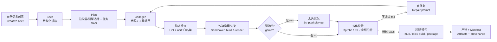

# vibe-coding-4-animation-coding

> 用 Vibe Coding 写“生成媒体与游戏的代码”，而不是让多模态模型直接产出媒体。
> Write code that makes media and games — instead of asking a multimodal model to make them.

**状态 / Status:** 实现阶段。已跑通 10 条确定性媒体路线（video/image/audio/film/game/layout/type/spectrum/ink/anime；除 film 外每条都有人类确认过的 golden 内容哈希与被突变体验证过的验收门，film 的哈希是输入容器哈希的函数，改走跨节点校验，见 §0 表）+ 管线骨架（capability registry、带内容哈希缓存的 DAG 执行器、`vcac run/doctor` CLI）+ 模拟故障注入测试层。工程台账见 `docs/audit-2026-11-05.md`；下文尚未实现的部分（planner/codegen/sandbox/playtest、完整 CLI 子命令、tests 全层矩阵）仍按目标设计描述。
**Status:** Implementation stage. Ten deterministic media routes (video/image/audio/film/game/layout/type/spectrum/ink/anime; every one but film has a human-confirmed golden content hash plus mutant-verified acceptance gates — film's hash is a function of its inputs' container hashes, so it is cross-checked between executor and direct run instead, see the §0 table). Also built: the pipeline skeleton (capability registry, content-hash-cached DAG executor, `vcac run/doctor` CLI) and a fault-injection simulation tier. The engineering ledger is `docs/audit-2026-11-05.md`; parts below that are not built yet (planner/codegen/sandbox/playtest, the full CLI surface, the full test-layer matrix) still describe the target design.

### 0. 已跑通的路线 / The routes that actually run

每条路线都是一个 `medium` 名 + 一份 spec + 一组**实测**验收门 + 一个人类确认过的 golden 内容哈希，外加至少一个**被看着变红**的突变体（或一条拒绝规则）。表里的哈希由另一个进程记录、由 `tests/e2e` 断言，所以一次普通 pass 同时就是跨进程可复现性证明。“规则数”只数 spec 里的 acceptance 条目；路由额外测了确定性时，`validate` 会再追加一条 `determinism` 检查。

| medium | 路由 module | spec | 渲染工具 | golden 内容哈希 | acceptance 规则数 |
| --- | --- | --- | --- | --- | --- |
| `video` | `firstloop` | `orbiting-cubes.yaml` | Pillow 逐帧 + FFmpeg | `d27999e7…` | 3 |
| `image` | `image_sample` | `poster-noise.yaml` | Pillow/NumPy + FFmpeg 图像编码 | `d538c350…` | 3 |
| `audio` | `audio_sample` | `synth-pad.yaml` | SciPy 加法合成 + FFmpeg R128 | `2f9351c5…` | 7 |
| `audio` (sampled) | `audio_sample` | `kern-piano.yaml` | **FluidSynth 2.6.2** + FluidR3_GM（仓库自带，不入 git） | `b5bf04fd…` | 8 |
| `film` | `film_sample` | `film-mux.yaml` | FFmpeg 装配（音画同步实测） | *无 pinned 哈希*：它是输入容器哈希的函数，改由 `test_pipeline_bundle` 与直接 `film_sample.run` 交叉校验 | 4 |
| `game` | `game_sample` | `dodge-headless.yaml` | 纯 Python 定步长模拟 | `c67acbf8…` | 4 |
| `layout` | `layout_sample` | `swiss-poster.yaml` | Playwright/Chromium（PNG+PDF 同源） | `ce95c593…` | 7 |
| `type` | `type_sample` | `variable-weight.yaml` | fontTools 可变字体实例化 | `3796ddf4…` | 4 |
| `spectrum` | `spectrum_sample` | `spectrogram-truth.yaml` | SciPy STFT → 图 → 再读出音高 | `e3591c8c…` | 7 |
| `ink` | `ink_landscape` | `ink-landscape.yaml` | 九步水墨链（Pillow+SciPy），题款用 OFL 行书 | `7b767025…` | 8 |
| `anime` | `anime_sample` | `anime-eave.yaml` | Pillow cel 渲染 + FFmpeg；镜头切换由直方图 TV 实测 | `c05722c8…` | 4 |

> 空间账：`outputs/` 全部可再生（git 不存）；`assets/` 里 151 MB 的工具与素材同样不入 git，只有 `assets/assets.lock.json`（194 B）入库，取用走 `python scripts/fetch_assets.py`。

---

## 1. 项目简介 / Overview

**中文**

本目录的目标是生成有趣的**视觉图像、音频、视频**，并进一步组合成**动画、短片甚至电影**；同时也生成**可玩的游戏**（2D/3D、网页游戏、互动叙事等）。

与传统 AIGC 管线不同，这里**不调用文生图、文生视频、音乐生成等多模态大模型**来直接合成像素或波形。我们采用 **Vibe Coding** 的方式：由 LLM 理解创作意图，编写可执行代码，或生成对**专业创作工具**（作曲、绘画、排版、剪辑、三维、合成、游戏引擎等）的调用脚本；真正的画面、声音、影片与游戏由这些代码与工具**确定性地渲染或运行**出来。

一句话概括：

> **模型负责“写程序”，程序负责“做媒体与游戏”。**
> The model writes the program; the program makes the media and the game.

**English**

This repository aims to produce interesting **still images, audio, and video**, compose them into **animations, short films, and eventually films**, and also generate **playable games** (2D/3D, web games, interactive fiction, etc.).

Unlike a conventional AIGC pipeline, it does **not** call multimodal image/video/music generation models to synthesize pixels or waveforms directly. Instead it uses **vibe coding**: an LLM interprets the creative brief and writes executable code, or generates invocation scripts for **professional media tools** (composition, drawing, typesetting, editing, 3D, synthesis, game engines, etc.). The actual images, sound, film, and gameplay are rendered or executed **deterministically** by that code and those tools.

In one sentence:

> **The model writes the program; the program makes the media and the game.**

### 1.1 为什么不用多模态模型 / Why not a multimodal model

| 维度 | 多模态模型直接生成 | 本项目：代码 + 专业工具 |
| --- | --- | --- |
| 可控性 Controllability | 提示词级，细节难以精确约束 | 参数、时间轴、坐标系、音符级可控 |
| 可复现性 Reproducibility | 受采样与模型版本影响 | 固定种子、版本与代码即可复现 |
| 可编辑性 Editability | 通常需要重生成 | 直接改代码/参数，增量渲染 |
| 可组合性 Composability | 模态之间难以精确对齐 | 统一时间轴与 Artifact DAG，可精确同步 |
| 交互性 Interactivity | 难以生成可运行、可测试的玩法逻辑 | 代码即玩法，可无头试玩与状态断言 |
| 运行成本 Cost | 依赖 GPU 与大模型推理 | 多数任务 CPU 即可，本地运行 |
| 版权与依赖 Licensing | 训练数据与模型许可复杂 | 工具链许可清晰，产物可审计 |
| 学习价值 Learning | 黑盒 | 代码即教程，过程可读可改 |

代价是需要工程化的**规划、沙箱、校验与自修复**循环。这正是本项目要解决的核心问题。

The trade-off is that we need an engineered loop of **planning, sandboxing, validation, and self-repair** — which is exactly what this project builds.

### 1.2 English Summary

- **Outputs:** interesting still images, audio, video, animations, short films, and **playable games** (2D/3D, web games, interactive fiction).
- **Method:** no multimodal generation models. An LLM writes executable code or invocation scripts for **professional tools** (music21, LilyPond, FluidSynth, Blender, Manim, FFmpeg, Pygame, Godot, Phaser, Ren'Py, etc.). The tools render or run the final media; the model never synthesizes pixels or waveforms directly.
- **Pipeline:** `brief → spec.yaml → plan.json (DAG) → generated code → static checks → sandboxed build/render → playtest (games) → validation → repair loop → assembly/packaging → manifest.json`.
- **Structure (actual today):** a flat Python package `src/vcac/` — route modules (`firstloop`, `image_sample`, `audio_sample`, `film_sample`, `game_sample`, `layout_sample`, `type_sample`, `spectrum_sample`, `ink_landscape`, `anime_sample`), shared primitives (`spec`, `validate`, `provenance`, `media`, `audio`, `ffmpeg`, `browser`), and the pipeline skeleton (`registry`, `pipeline`, `cli`); plus `specs/`, `tests/` (unit/e2e/simulation), and `docs/`. The `planner`/`codegen`/`sandbox`/`playtest` split and the `renderers/` tree remain the target design (§4).
- **Reproducibility:** fixed seeds, pinned tool versions, content-hash caching, and a provenance manifest so any run can be rebuilt.
- **Environment:** `conda activate hy_py312` (Python 3.12.13, NumPy, Pillow, OpenCV, SciPy, FFmpeg verified); other renderers and engines are optional, installed on demand.
- **Non-goals:** training media models, wrapping cloud text-to-image/video/music APIs, or building a general-purpose game engine from scratch.

The sections below give the full design in Chinese with bilingual headings and terminology.

---

## 2. 核心原则 / Core Principles

1. **规格先行 / Spec first** —— 先把自然语言意图固化为结构化 Spec（YAML），再进入生成。
2. **模型只写代码 / Code, not pixels** —— LLM 的输出是代码、脚本、参数或工具调用清单，不是媒体本身。
3. **专业工具优先 / Professional tools first** —— 优先使用成熟渲染器，而不是重新发明渲染管线。
4. **确定性 / Deterministic** —— 固定随机种子、分辨率、帧率、工具版本；同一输入应得到同一输出。
5. **可验证 / Verifiable** —— 每个产物都经过客观指标检查（时长、分辨率、响度、黑帧、静音等）。
6. **可组合 / Composable** —— 图像、音频、视频、游戏资产是 Artifact DAG 上的节点，可被下游步骤复用与拼装。
7. **可试玩 / Playable** —— 游戏不仅要有画面与声音，还要有可运行、可复现、可自动试玩的玩法闭环。
8. **本地优先 / Local first** —— 默认离线运行，不依赖云端推理服务。
9. **可审计 / Auditable** —— 记录提示词、计划、代码哈希、工具版本与种子，形成 provenance。

---

## 3. 产物类型与工具矩阵 / Outputs and Tool Matrix

| 模态 Medium | 代表工具 Tools | 典型用途 Typical use |
| --- | --- | --- |
| 静态图像 Still image | Pillow, SVG, Cairo, ImageMagick | 海报、插画、纹理、程序化图案 |
| 数据与图表 Data viz | Matplotlib, Plotly, Graphviz, TikZ/LaTeX | 信息图、数学示意图、关系图 |
| 程序化图形 Generative graphics | GLSL shaders, p5.js, Processing, Three.js | 粒子、噪声、灯光、交互式视觉 |
| 三维 3D | Blender (headless), OpenSCAD, POV-Ray | 建模、材质、灯光、三维动画 |
| 符号音乐 Symbolic music | music21, SCAMP, ABC notation, MIDI | 旋律、和声、配器、乐谱 |
| 音频合成 Audio synthesis | SuperCollider, Csound, ChucK, FluidSynth, SoX | 合成器音色、音效、混音与母带 |
| 乐谱排版 Score engraving | LilyPond, MuseScore CLI | 出版级乐谱与分谱 |
| 视频合成 Video compositing | FFmpeg, MoviePy, ImageMagick | 剪辑、转场、字幕、色彩、封装 |
| 程序化动画 Animation | Manim, Remotion, Motion Canvas, Lottie | 数学动画、React 视频、UI 动效 |
| 影片装配 Film assembly | FFmpeg + EDL/时间轴 + 字幕 | 分镜、镜头拼接、音画同步、成片输出 |
| 2D 游戏 2D game | Pygame, Arcade, LÖVE, Phaser | 平台跳跃、射击、解谜、街机 |
| 3D 游戏 3D game | Godot, Three.js / Babylon.js, Bevy | 第一/第三人称、场景探索、原型 |
| 互动叙事 Interactive fiction | Ren'Py, Ink, Twine | 视觉小说、分支剧情、文字冒险 |
| 游戏素材 Game assets | Aseprite CLI, Tiled, Blender, SVG | 精灵图、瓦片地图、关卡、UI、音效 |
| 版面与出版 Layout & print | pandoc, MiKTeX/TikZ, libass(ASS), Marp, D2, Vega-Lite | 讲义、书/报、字幕卡、图示、信息图 |
| 浏览器作为渲染器 Browser as renderer | Playwright/Chromium, Chrome·Edge headless, HTML/CSS/SVG/Canvas/WebGL | 海报、deck、动态字体、shader 艺术截图（本机已实测可用） |
| 图案与装饰系统 Ornament & pattern systems | NumPy/OpenCV 对称群、镶嵌、girih/kolam/凯尔特结、十字绣矩阵 | 规则纹样、套色装饰、织物图样 |
| 实物输出 Physical output | Ghostscript（印前）、PrusaSlicer（G-code）、vsketch/vpype（笔绘仪） | 印张、切片文件、plotter 线稿 |
| 捕获重建 Capture & rebuild | COLMAP、Hugin/enblend（headless 全景） | 照片→相机轨迹/点云/全景（**输入即资产**，需素材溯源） |

> 说明：上表是**能力池**，不是强制依赖。各渲染器按需安装，未安装时能力注册表会自动降级或提示。
> Note: this is a **capability pool**, not a hard dependency list. Renderers are installed on demand; the capability registry degrades gracefully when one is missing.
> **本表不声称穷尽。** 完整媒体类型矩阵、六条分类轴、逐格判定与“代码补不上的残余边界”（现场在场、多通道感知）
> 在 `docs/coverage-audit.md`；工具版本/许可/headless 实况在 `docs/tools.md`（含 §0.1/§0.2 本机两轮实测）；
> 风格可否形式化在 `docs/styles.md`。新增模态时**三处都要登记**，以 `docs/coverage-audit.md` 为台账。

> 图像、音频、视频以**文件**为最终产物；游戏以**可运行构建 + 试玩证据**为最终产物（网页构建、可执行文件、截图、状态轨迹）。
> Images, audio, and video ship as **files**; games ship as a **runnable build plus playtest evidence** (web build, executable, screenshots, state traces).

**明确排除 / Explicitly out of scope:** 扩散模型、文生图/文生视频模型、TTS/歌声合成模型、神经渲染、任何“提示词直接出媒体”的云端 API。项目的智能体现在**代码合成与工程编排**，而不是模型推理。

---

## 4. 规划目录结构 / Planned Layout

```text
vibe-coding-4-animation-coding/
├── README.md
├── pyproject.toml                  # 包元数据与可选依赖 extras
├── environment.yml                 # conda 环境定义（hy_py312）
├── Makefile / justfile             # 常用任务入口
│
├── src/vcac/                       # 核心 Python 包
│   ├── cli.py                      # 命令行入口：plan / render / play / inspect / remake
│   ├── config.py                   # 路径、工具路径、全局配置
│   ├── spec.py                     # Spec 数据模型与 JSON Schema 校验
│   ├── planner.py                  # 意图 → 任务 DAG（LLM）
│   ├── codegen.py                  # DAG 节点 → 代码/调用清单（LLM）
│   ├── registry.py                 # 渲染器能力注册表（可用性探测）
│   ├── sandbox.py                  # 子进程隔离、超时、资源与网络限制
│   ├── pipeline.py                 # DAG 调度、缓存、失败重试
│   ├── playtest.py                 # 无头试玩：脚本输入、截图、状态断言
│   ├── validate.py                 # 媒体探针与验收规则
│   ├── provenance.py               # manifest 与可复现性记录
│   ├── renderers/
│   │   ├── base.py                 # Renderer 抽象接口
│   │   ├── image/                  # svg, pillow, matplotlib, glsl, blender-still
│   │   ├── audio/                  # music21, scamp, lilypond, fluidsynth, sox
│   │   ├── video/                  # manim, moviepy, ffmpeg, remotion, blender
│   │   └── game/                   # pygame, arcade, phaser, godot, renpy
│   └── templates/                  # 各工具的代码模板与 API 速查
│
├── prompts/                        # Vibe Coding 提示词资产
│   ├── system.md                   # 角色、约束、输出格式
│   ├── planner.md                  # 规划阶段提示词
│   ├── codegen_image.md
│   ├── codegen_audio.md
│   ├── codegen_video.md
│   ├── codegen_game.md
│   └── repair.md                   # 基于校验反馈的修复提示词
│
├── specs/                          # 可读的创作规格
│   ├── schema/spec.schema.json
│   └── examples/
│       ├── poster-noise.yaml
│       ├── math-animation.yaml
│       ├── short-film.yaml
│       └── neon-dodger.yaml
│
├── assets/                         # 字体、采样、纹理、参考素材
├── outputs/                        # 渲染产物与游戏构建（gitignore）
├── tests/
│   ├── unit/                       # spec、registry、validate 的单元测试
│   ├── contract/                   # 渲染器/引擎契约测试（最小输入 → 已知输出）
│   ├── fixtures/                   # 测试夹具：极小规格、合成素材、黄金样本
│   │   ├── specs/                  # image/audio/video/film/game 各一份最小 spec
│   │   ├── assets/                 # 棋盘格、正弦波、彩条、微型关卡
│   │   └── golden/                 # 关键帧 pHash、音频指纹、试玩轨迹
│   ├── mocks/                      # 假 LLM、假渲染器、故障注入工具
│   ├── e2e/                        # 端到端最小渲染与试玩
│   └── soak/                       # 长时运行、内存泄漏、稳定性
├── docs/
│   ├── architecture.md
│   ├── workflow.md
│   ├── tools.md                    # 工具生态实况（版本·许可·headless·本机实测）
│   ├── styles.md                   # 画法与风格能否被代码复现（风格谱系地图）
│   ├── coverage-audit.md            # 穷尽性审计台账：六条分类轴 × 逐格判定 × 残余缺口
│   ├── roadmap-development.md        # 路线开发规划（闭环队列/安装队列/诚实边界）
│   ├── testing.md                  # 测试矩阵、阈值与模拟内容说明
│   └── prompting.md                # Vibe Coding 经验与反模式
└── scripts/                        # 环境检查、批量渲染、发布辅助
    └── simulate.py                 # 生成合成测试内容与模拟输入
```

**分层职责 / Layering**

- `spec` 层只描述“要什么”，不关心“怎么做”。
- `planner` 决定“用哪些渲染器或引擎、按什么顺序”。
- `codegen` 生成“可执行的东西”，并受模板与白名单约束。
- `sandbox` 负责“安全地跑”。
- `validate` / `playtest` 负责“证明结果符合规格、游戏可玩”。
- `pipeline` 负责“串起来、缓存、重试、记录”。

---

## 5. 工作流 / Workflow



### 5.1 阶段说明 / Stages

| # | 阶段 Stage | 输入 Input | 输出 Output | 负责组件 Component |
| --- | --- | --- | --- | --- |
| 1 | 意图捕获 Intent | 自然语言 brief | `spec.yaml` | 人 + `spec.py` |
| 2 | 规划 Plan | Spec + 能力注册表 | `plan.json`（DAG） | `planner.py` |
| 3 | 代码生成 Codegen | DAG 节点 + 工具模板 | 源码 / 参数文件 | `codegen.py` |
| 4 | 静态检查 Static check | 代码 | 通过/拒绝 + 诊断 | `sandbox.py` |
| 5 | 构建/渲染 Build & Render | 代码 / 调用清单 | 帧、音频、游戏构建、中间文件 | `renderers/*` |
| 6 | 试玩 Playtest | 游戏构建 + 脚本化输入 | 截图、状态轨迹、通过/失败 | `playtest.py` |
| 7 | 校验 Validate | 中间产物 | 指标 + 验收结论 | `validate.py` |
| 8 | 自修复 Repair | 失败指标 + 日志 | 补丁后的代码 | `codegen.py` + `prompts/repair.md` |
| 9 | 装配/打包 Assemble & Package | 通过校验的片段/构建 | 成片 / 最终图 / 音频 / 可运行游戏 | FFmpeg、引擎导出 |
| 10 | 归档 Archive | 全链路记录 | `manifest.json` + 预览 | `provenance.py` |

### 5.2 详细步骤 / Detailed Steps

1. **Brief → Spec**
   将“做一段 12 秒、冷色调、几何立方体随 Techno 节奏旋转的短片”或“做一个霓虹色、30 秒一局的躲避小游戏”转成结构化字段：时长/局时长、分辨率、帧率、调色板、节奏、乐器、时间轴/关卡事件、操作方式、验收标准。歧义处显式记录假设，而不是让模型自由发挥。

2. **Spec → Plan**
   LLM 读取**能力注册表**（当前机器上真正可用的工具及其版本），产出一个 DAG。例如：`score(music21) → render_audio(fluidsynth) → render_frames(manim) → mux(ffmpeg)`，或 `assets(aseprite) → level(tiled) → game(pygame) → playtest(pygame-headless) → build(pyinstaller/web)`。每个节点声明输入、输出、参数、种子与预估资源。

3. **Plan → Code**
   每个节点基于**受约束的模板**生成代码或调用清单。模板提供经过验证的 API 片段、常见陷阱和输出路径约定，降低“幻觉 API”的概率。生成结果必须可独立运行，并写入约定的输出目录。

4. **静态检查 / Static Check**
   语法解析（AST）、导入白名单、禁止网络与危险系统调用、检查输出路径是否越界、确认依赖在注册表中可用。此阶段不执行代码。

5. **沙箱构建/渲染 / Sandboxed Build & Render**
   在独立子进程中运行，设置超时、内存/CPU 限制、工作目录隔离、禁用网络；捕获 stdout/stderr 与退出码。长任务支持断点与分段渲染；游戏构建在虚拟显示或无头模式下完成。

6. **校验 / Validate**
   用客观探针检查：
   - 图像：尺寸、色彩模式、非空像素比例、感知哈希、关键帧拼图；
   - 音频：采样率、声道、时长、峰值/RMS/LUFS、静音段、削波；
   - 视频：容器、编码、分辨率、帧率、时长、黑帧、冻结帧、音画偏移；
   - 游戏：窗口/画布尺寸、启动成功、脚本输入后状态变化、帧率下限、崩溃与卡死、资源缺失。
   对照 Spec 中的 `acceptance` 规则逐条判定。

7. **试玩 / Playtest（游戏专属）**
   以**无头模式**启动游戏，注入脚本化输入（按键序列、鼠标轨迹、固定时间步），采集截图、日志与状态轨迹；断言“角色能移动”“碰撞会扣血”“30 秒内可结束”“无异常退出”。必要时再录制一段真实渲染的试玩视频作为人工评审素材。

8. **自修复 / Repair Loop**
   失败时把**结构化诊断**（哪条规则、期望值、实际值、相关日志片段）回灌给 LLM，要求最小补丁而非整段重写。默认最多 N 轮（建议 3），仍失败则标记为需人工介入，保留所有中间产物。

9. **装配/打包 / Assemble & Package**
   - 影视：统一时间轴，拼接镜头，混音与响度归一化，叠加字幕，封装为 `mp4` / `wav` / `png` / `svg`。
   - 游戏：导出网页构建（HTML/JS/WASM）或桌面可执行文件，打包素材、关卡、存档与说明，保留可复现的构建脚本。
   装配与打包本身也由代码或工具命令完成，可复现。

10. **归档 / Package**
   写出 `manifest.json`：Spec、Plan、代码哈希、工具版本、种子、运行时长、验收与试玩结果、产物清单。支持 `vcac remake` 从 manifest 精确重跑。

---

## 6. 关键设计 / Key Design

### 6.1 创作规格 Spec

Spec 是人与模型之间的**契约**，也是验收依据。它应当：

- 用 YAML 编写，便于人读与人改；
- 有 JSON Schema，可在生成前校验；
- 区分**意图字段**（风格、情绪）与**硬约束**（时长、分辨率、帧率）；
- 包含 `acceptance` 列表，让“好不好”尽量变成“是否满足”。

### 6.2 能力注册表 Capability Registry

启动时探测本机工具：`ffmpeg -version`、`blender --version`、`lilypond --version`、Python 包是否可导入等。注册表输出：

```json
{
  "ffmpeg": {"available": true, "version": "N-125875", "kind": "video"},
  "manim": {"available": false, "reason": "module not found"},
  "fluidsynth": {"available": false, "reason": "binary not on PATH"}
}
```

规划器只能选择 `available: true` 的渲染器；缺失时给出安装建议或降级方案（例如用 Pillow 替代 Blender 出静帧）。

### 6.3 受约束代码生成 Constrained Codegen

- **模板优先**：每个渲染器维护最小可运行示例与 API 速查。
- **契约固定**：入口函数、参数、输出路径、日志格式统一。
- **小步生成**：一次只生成一个 DAG 节点，便于定位错误。
- **禁止清单**：网络请求、`eval/exec`、任意文件删除、系统级修改。
- **可读性**：生成代码需带注释与参数说明，因为代码本身就是可编辑的创作介质。

### 6.4 沙箱与安全 Sandbox

| 风险 | 措施 |
| --- | --- |
| 生成代码执行任意命令 | AST 白名单 + 子进程隔离 + 禁用 shell 拼接 |
| 无限循环 / 卡死 | 超时、心跳日志、可中断 |
| 内存爆掉 | 资源限制、分段渲染、降分辨率预览 |
| 写到仓库外 | 工作目录沙箱 + 路径规范化检查 |
| 联网拉取未知资源 | 默认断网；素材需预先放入 `assets/` |
| 供应链风险 | 依赖版本锁定，工具路径可配置 |

### 6.5 可复现与溯源 Reproducibility & Provenance

一次运行由以下因素决定：

```text
hash(spec + plan + generated_code + tool_versions + seeds + asset_hashes)
```

该哈希作为缓存键与运行 ID。相同哈希应复用缓存；显式 `--no-cache` 可强制重跑。`manifest.json` 记录全部输入，使产物在数月后仍可重建。

### 6.6 装配与时间轴 Assembly & Timeline

- 所有模态共用一条**秒级时间轴**，音频事件、镜头切换、字幕共用同一时钟。
- 视频以帧为单位、音频以采样为单位，装配阶段统一换算，避免累积漂移。
- 使用 FFmpeg 做最终封装；中间格式优先无损或高质量（PNG 序列、WAV、ProRes 可选）。

### 6.7 缓存与增量渲染 Caching & Incremental Rendering

- 按节点哈希缓存中间产物（帧序列、音频轨、单镜头、游戏构建）。
- 只重渲染受影响的子图：改配色不影响配乐，改配乐不影响已渲染画面。
- 预览模式：低分辨率、低帧率、短时长，用于快速迭代；确认后再全质量渲染。

### 6.8 游戏与交互 Games & Interaction

游戏是“可运行的媒体”，因此比静帧/视频多一层**运行时**约束。设计要点：

- **固定时间步 / Fixed timestep**：逻辑更新与渲染解耦，保证同一输入序列产生同一结果。
- **无头模式 / Headless mode**：游戏必须支持无窗口运行（虚拟显示或引擎 headless），供 CI 自动试玩。
- **输入脚本 / Scripted input**：用 `[{frame, key, action}]` 描述按键、鼠标与时间推进，可回放、可对比。
- **状态断言 / State assertions**：暴露只读状态快照（玩家坐标、血量、分数、关卡、实体数量），用于“玩法是否正确”的检查，而不只看截图。
- **确定性种子 / Deterministic seed**：程序化关卡、敌人刷新、掉落与音效随机均使用统一种子。
- **素材管线 / Asset pipeline**：精灵图、瓦片地图、字体、音效由上游渲染器生成，游戏只负责组装与逻辑。
- **构建产物 / Build artifacts**：网页构建优先（易分享、易自动截图），桌面构建次之；构建脚本与版本一并记录。
- **可访问性 / Accessibility**：键位可配置、可暂停、可静音、字号与对比度可调，作为验收项而非附加项。

**游戏 Spec 的额外字段（目标）**

```yaml
game:
  genre: arcade-dodge
  engine: pygame            # pygame | phaser | godot | renpy
  viewport: {width: 960, height: 540}
  input: [arrow-keys, wasd]
  session: {target_seconds: 30, win_score: 100}
  playtest:
    script: scripts/dodge-smoke.json
    assertions:
      - player moves when ArrowLeft is held
      - collision reduces hp by 1
      - session ends within 35s
      - no unhandled exception
```

> 本项目**不自己实现通用游戏引擎**，而是复用 Pygame / Phaser / Godot / Ren'Py 等成熟引擎；LLM 负责写玩法代码、关卡数据与构建脚本。

---

## 7. 环境与依赖 / Environment

**测试环境 / Test environment**

```powershell
conda activate hy_py312
python -V
```

当前已在 `hy_py312` 中确认：

| 组件 Component | 版本 Version | 状态 Status |
| --- | --- | --- |
| Python | 3.12.13 | 可用 Available |
| NumPy | 2.3.5 | 可用 Available |
| Pillow | 12.3.0 | 可用 Available |
| OpenCV | 4.10 / 5.0 | 可用 Available |
| SciPy | 1.18.0 | 可用 Available |
| FFmpeg | N-125875 (winget)；另一构建 **8.1.1-full_build** 在 PATH（两者并存，口径差异见 `docs/tools.md` §0） | 可用 Available |

> ⚠ **环境事实纠正（2026-11-04 穷尽性审计第二轮实测）**：本机其实有**两个 Python**，能力集不同——
> 上表的 `hy_py312`（3.12.13，**已跑的 5 条路线与全部 golden manifest 均产自它**）**不含** matplotlib / fonttools / playwright；
> 而 PATH 默认的 `C:\Python313`（**3.13.5**）里有：matplotlib 3.11.0、fonttools 4.63.0、playwright 1.58.0（+已下载 Chromium 145.0.7632.6）、pypdf 6.19.0、scikit-image **无**。
> 测试现状：**108 项**（3.13.5，playwright+fontTools 在位，全绿）；hy_py312 下其中 12 项浏览器/可变字体测试 skip（importorskip 门控；本轮新增的 17 项未在 hy_py312 复跑，108 这个数只在 3.13.5 实测）。因此：“某工具已装”必须说明**在哪个解释器**；`python scripts/doctor.py` 已改为输出 `sys.executable`+`sys.prefix`，**逐解释器跑一次再引用结论**。
> 选定交付环境（装进 hy_py312，或正式切换到 3.13.5）属人工决策，未得同意不自定。

**按需安装 / Optional extras**（规划中，按渲染器启用）

```powershell
# 图像与数据可视化
pip install matplotlib plotly graphviz

# 动画与视频
pip install manim moviepy imageio[ffmpeg]

# 音乐与音频
pip install music21 scamp librosa soundfile pydub
# 外部工具：LilyPond、FluidSynth、SuperCollider、Blender（需单独安装并加入 PATH）

# 游戏与交互
pip install pygame-ce arcade
# 外部工具：Godot、Ren'Py、LÖVE（独立安装）；Phaser / Three.js 需要 Node.js
npm install phaser three
```

**环境定义 / Environment file（目标）**

```yaml
# environment.yml
name: hy_py312
channels: [conda-forge]
dependencies:
  - python=3.12
  - numpy
  - scipy
  - pillow
  - opencv
  - ffmpeg
  - pip
  - pip:
      - pydantic>=2
      - pyyaml
      - jsonschema
      - typer
      - rich
```

**环境自检 / Doctor**

```powershell
python scripts/doctor.py     # 打印能力注册表与缺失依赖建议
```

---

## 8. 快速开始 / Quickstart

> **已实现：** `vcac run <spec-or-bundle.yaml> [--out DIR] [--no-cache]` 与 `vcac doctor`（argparse，见 `src/vcac/pipeline.py`）。
> **已实现 / Implemented.** 其余子命令（spec/plan/render/inspect/remake/play/build）仍是目标接口。
> **Still target-only / Not implemented yet:** the remaining subcommands below.

```powershell
conda activate hy_py312
pip install -e ".[dev]"

# 1. 从自然语言生成并校验 Spec
vcac spec "12 秒冷色调几何立方体短片，96 BPM，A 小调" --out specs/examples/orbiting-cubes.yaml

# 2. 规划渲染 DAG（会读取本机能力注册表）
vcac plan specs/examples/orbiting-cubes.yaml

# 3. 全流程渲染（规划 → 生成 → 沙箱 → 校验 → 装配）
vcac render specs/examples/orbiting-cubes.yaml --out outputs/orbiting-cubes

# 4. 查看验收报告与预览
vcac inspect outputs/orbiting-cubes

# 5. 用同一 seed 精确重跑
vcac remake outputs/orbiting-cubes --seed 42

# 6. 游戏：无头试玩 + 打包
vcac play specs/examples/neon-dodger.yaml --script scripts/dodge-smoke.json
vcac build specs/examples/neon-dodger.yaml --target web --out outputs/neon-dodger

# 7. 测试矩阵：合成内容 + Mock 工具，无需真实渲染器
pytest -q
python scripts/simulate.py --medium all --out outputs/_simulation
```

**分阶段调试 / Debug by stage**

```powershell
vcac render spec.yaml --only plan
vcac render spec.yaml --only codegen
vcac render spec.yaml --only render --preview
vcac render spec.yaml --skip-repair --max-rounds 0
vcac play spec.yaml --headed          # 有窗口试玩（人工）
vcac play spec.yaml --headless        # 无头试玩（CI）
```

---

## 9. 示例规格 / Example Specs

### 9.1 短片规格 / Video Spec

```yaml
# specs/examples/orbiting-cubes.yaml
id: orbiting-cubes
title: Orbiting Cubes
medium: video

format:
  width: 1920
  height: 1080
  fps: 30
  duration: 12s
  container: mp4

style:
  palette: ["#0B1020", "#4FD1C5", "#F6AD55"]
  mood: minimal, geometric, cold
  typography: none

audio:
  enabled: true
  tempo: 96
  key: A minor
  instruments: [synth-pad, marimba]
  target_lufs: -16

timeline:
  - { at: 0s,  action: fade-in,  duration: 1s }
  - { at: 1s,  action: cubes-orbit, ease: ease-in-out }
  - { at: 10s, action: fade-out, duration: 2s }

render:
  preferred: [manim, ffmpeg]
  seed: 42
  preview: false

acceptance:
  - duration between 11.8s and 12.2s
  - resolution exactly 1920x1080
  - no black frame longer than 0.5s
  - audio peak below -1 dBFS
  - audio not silent
```

### 9.2 游戏规格 / Game Spec

```yaml
# specs/examples/neon-dodger.yaml
id: neon-dodger
title: Neon Dodger
medium: game

game:
  genre: arcade-dodge
  engine: pygame
  viewport: { width: 960, height: 540 }
  input: [arrow-keys, wasd]
  session: { target_seconds: 30, win_score: 100 }
  difficulty: { start: easy, ramp_per_second: 0.15 }

style:
  palette: ["#05010A", "#FF2E88", "#00E5FF", "#FFE66D"]
  mood: neon, retro, fast

audio:
  enabled: true
  tempo: 128
  key: F# minor
  instruments: [bass-synth, arp]
  target_lufs: -14

assets:
  sprites: generated        # 由上游 SVG/Pillow 渲染器生成
  font: assets/fonts/mono.ttf

playtest:
  script: scripts/neon-dodger-smoke.json
  assertions:
    - game launches within 3s
    - player moves when ArrowLeft is held
    - score increases when an orb is collected
    - collision reduces hp by 1
    - session ends within 35s
    - no unhandled exception

build:
  targets: [web, windows]
  seed: 42
```

---

## 10. 产物布局 / Output Layout

```text
outputs/<run-id>/
├── spec.yaml              # 实际使用的规格（含默认值展开）
├── plan.json              # 渲染/构建 DAG
├── code/                  # 生成的代码与参数文件
├── logs/                  # 每节点 stdout/stderr
├── frames/                # 帧序列（可选保留）
├── audio/                 # 分轨与混音
├── preview.mp4            # 低质量预览（影视）
├── final.mp4              # 最终成片（影视）
├── contact-sheet.jpg      # 关键帧拼图，便于快速人工检查
├── waveform.png           # 音频波形/频谱预览
├── report.json            # 逐项验收结果（机器可读）
├── report.html            # 可视化测试报告
├── playtest/              # 试玩截图、输入回放、状态轨迹（游戏）
├── build/                 # 网页或桌面构建、启动脚本（游戏）
└── manifest.json          # 溯源与验收记录
```

`manifest.json` 示例字段：

```json
{
  "run_id": "sha256:9f2c...",
  "spec": "spec.yaml",
  "plan": "plan.json",
  "code_hashes": {"frames.py": "sha256:1a3b..."},
  "tools": {"ffmpeg": "N-125875", "python": "3.12.13"},
  "seeds": {"global": 42},
  "acceptance": {"passed": true, "checks": 12, "failed": 0},
  "test_report": {"layers": ["L0", "L1", "L2", "L3"], "passed": 87, "failed": 0},
  "playtest": {"runs": 3, "passed": 3, "screenshots": 6},
  "artifacts": ["final.mp4", "contact-sheet.jpg", "report.json"]
}
```

---

## 11. 路线图 / Roadmap

| 阶段 Phase | 目标 Goal | 交付 Deliverables |
| --- | --- | --- |
| P0 脚手架 | 包结构、Spec Schema、能力注册表、FFmpeg 装配 | `vcac` CLI 骨架、`doctor` |
| P1 图像 | SVG / Pillow / Matplotlib 渲染器与验收 | 静帧生成端到端可用 |
| P2 音频 | music21 / SCAMP 作曲，FluidSynth 或 SoX 出声 | MIDI → WAV，响度校验 |
| P3 视频 | Manim / MoviePy + FFmpeg 时间轴 | 短片端到端可用 |
| P4 三维与前端 | Blender headless、Remotion / Motion Canvas | 更丰富的镜头语言 |
| P5 游戏与交互 | Pygame / Phaser / Ren'Py 渲染器，无头试玩与状态断言 | 可运行网页小游戏 + 试玩报告 |
| P6 影片装配 | 分镜、镜头表、字幕、音画同步 | 多镜头短片 |
| P7 测试与评估 | 分层测试、各模态验收矩阵、模拟内容与故障注入、黄金样本、提示词回归 | 质量基线与可视化测试报告 |

**建议的首个里程碑 / First milestone:** 一条 6 秒、无音频、Pillow 逐帧渲染 + FFmpeg 编码的短片，附带完整 manifest、三项验收规则，并通过 L0–L2 测试。先跑通闭环，再扩展工具。

**第二条闭环 / Second milestone:** 一个 30 秒的 Pygame 街机小游戏，包含程序化精灵、简单音效、脚本化无头试玩、3 次确定性回放与网页构建。它验证“代码 → 可运行玩法 → 自动验收”的完整路径。

---

## 12. 测试与评估 / Testing and Evaluation

> **结论先行：** 仅“能生成一个文件”不算通过。测试必须按产物类型分别验证**可解码、符合规格、内容非空、时间/音画同步、确定性、可交互**。图像、音频、视频、电影走“文件验收”；游戏走“可运行构建 + 模拟试玩 + 状态断言”。

### 12.1 测试分层 / Test Layers

| 层级 Layer | 内容 What | 运行时机 When | 耗时 Budget |
| --- | --- | --- | --- |
| L0 单元 Unit | Spec Schema、路径沙箱、DAG 拓扑、缓存键、哈希 | 每次提交 | 秒级 |
| L1 契约 Contract | 每个渲染器/引擎用最小夹具产出已知结果 | 每个 PR | 分钟级 |
| L2 端到端 E2E | 每类产物跑完整 `spec → package` 流程 | PR / 每晚 | 十分钟级 |
| L3 模拟与故障 Simulation | 假 LLM、假工具、坏输入、超时、随机种子扫描、长时运行 | 每晚 / 发布前 | 小时级 |
| L4 人工评审 Human | 关键帧拼图、试听、试玩录屏、审美判断 | 发布前 | 人工 |

### 12.2 模拟内容与测试夹具 / Fixtures & Simulated Content

测试不依赖“真实创作”才能跑；仓库内置一组**极小、确定性、可断言**的合成内容。

| 类型 Type | 夹具 Fixture | 用途 Purpose |
| --- | --- | --- |
| 图像 Image | 64×64 棋盘格、渐变图、1px 网格、带 alpha 的圆形 | 尺寸/通道/非空/调色板/透明通道 |
| 音频 Audio | 1s 440Hz 正弦、静音、削波、立体声相位测试 | 采样率/峰值/LUFS/静音/削波/频谱 |
| 视频 Video | 3s、320×180、12fps 彩条 + 1kHz 音调，固定 3 个切点 | 帧数/黑帧/冻结/切点/音画同步 |
| 电影 Film | 3 镜头 × 2s + 标题 + 字幕 + 片尾 | 镜头覆盖/转场/字幕/混音/连续性 |
| 游戏 Game | 10s 微型街机：移动、碰撞、得分、结束 | 启动/输入/状态断言/确定性/构建 |
| 坏输入 Malformed | 0 字节 PNG/WAV/MP4、错误字体、超大分辨率、缺失素材 | 错误处理与诊断质量 |

**模拟组件 / Mocks**

- `MockPlanner`：返回固定 DAG，隔离 LLM 的不确定性。
- `MockRenderer`：把帧号写进像素，便于验证帧序、丢帧与拼接。
- `MockTool`：模拟成功、非零退出、超时、输出缺失、日志乱码。
- `FakeClock` + 固定 RNG：让动画、粒子、敌人刷新完全可复现。
- `VCAC_TEST_MODE=1`：强制 320×180、5fps、2s、seed 0、禁用网络，保证 CI 快速稳定。
- `scripts/simulate.py`：批量生成上述合成 spec 与素材；黄金样本只能在人工确认后更新。

### 12.3 图像验收 / Image Checks

| 检查 Check | 判定 Rule（可按 spec 覆盖） |
| --- | --- |
| 可解码 Decodable | Pillow/OpenCV 能完整读取，无异常 |
| 格式与尺寸 Format/Size | 与 spec 完全一致；色彩模式符合预期 |
| 非空 Non-empty | 唯一颜色数 > 16；前景像素占比 > 1% |
| 非纯色 Not flat | 熵 > 阈值；不是全黑、全白或单色 |
| 调色板 Palette | 主色与 spec 的 ΔE2000 均值 < 5 |
| 黄金样本 Golden | 与基准 pHash 的 Hamming 距离 ≤ 8 |
| 透明通道 Alpha | 透明区域与边缘符合 spec（如启用） |
| 文字 Text | 字体回退有告警；可选 OCR 置信度检查 |
| 确定性 Determinism | 同 seed 两次渲染文件哈希一致 |
| 资源 Budget | 4K 图在时间/内存预算内完成 |

### 12.4 音频验收 / Audio Checks

| 检查 Check | 判定 Rule |
| --- | --- |
| 格式 Format | 采样率、声道数、编码与 spec 一致 |
| 时长 Duration | 目标时长 ±20ms |
| 峰值 Peak | ≤ -1 dBFS；true peak ≤ -1 dBTP |
| 响度 Loudness | 整体 LUFS 在目标 ±1 LU；LRA 在合理区间 |
| 静音 Silence | 非预期静音段不超过 0.5s；预期静音需在 spec 声明 |
| 削波 Clipping | 削波采样占比 < 0.01% |
| 直流偏移 DC | \|DC\| < 0.001 |
| 频谱 Spectrum | 测试音基频正确；非全零 FFT；无异常高频噪声 |
| 循环 Loop | 循环点无明显爆音（如声明 loop） |
| 同步 Sync | 与视频的偏移 ≤ 1 帧（约 33ms @30fps） |
| 完整解码 Decode | 全文件可解码，无 NaN/损坏帧 |

### 12.5 视频验收 / Video Checks

| 检查 Check | 判定 Rule |
| --- | --- |
| 容器与编码 Container/Codec | ffprobe 读出的容器、编码、pix_fmt 符合 spec |
| 分辨率与帧率 Resolution/FPS | 完全一致 |
| 时长与帧数 Duration/Frames | 时长 ±0.1s；帧数 = round(duration × fps) |
| 全帧解码 Full decode | 解码所有帧无错误；无丢帧告警 |
| 黑帧 Black frames | 连续黑帧 ≤ 0.5s；片头片尾除外需声明 |
| 冻结帧 Freeze | 连续相同帧不超过 spec 上限 |
| 场景切点 Scene cuts | 与时间轴切点数量误差 ≤ 1，位置 ±2 帧 |
| 黄金关键帧 Golden frames | 首/中/尾帧 pHash 或 SSIM 在阈值内 |
| 音画同步 A/V sync | 偏移 ≤ 1 帧 |
| 字幕 Subtitles | 所有 cue 在时长内，无重叠，起止时间正确 |
| 元数据 Metadata | SAR、色彩范围、旋转标记正确 |
| 资源 Budget | 4K/60fps 在时间/内存预算内，渲染日志无 dropped frame |

### 12.6 电影/多镜头验收 / Film Checks

- **镜头覆盖 / Shot coverage**：EDL 或镜头表中的每个镜头都已渲染，顺序与时长正确。
- **总时长 / Total duration**：与脚本目标误差 ≤ 0.2s；每镜头误差 ≤ 0.1s。
- **转场与字幕 / Transitions & subtitles**：淡入淡出、标题、字幕、片尾均存在且时间正确。
- **混音 / Mix**：对白、音乐、音效分层存在；整体响度 -16 LUFS ±1 LU（可按发行平台覆盖）。
- **连续性 / Continuity**：同一场景的调色板、角色/道具 ID、场景编号在元数据中一致；无占位帧、缺素材、重复镜头。
- **重复检测 / Duplicate shots**：对镜头关键帧做哈希，避免误用同一片段。
- **成片复检 / Master re-check**：最终 `final.mp4` 重新跑一遍 12.5 的全部检查。
- **人工评审 / Human review**：联系表 + 每个场景至少 1 个关键帧 + 完整试听。

### 12.7 游戏验收 / Game Checks

| 维度 Dimension | 检查 Check |
| --- | --- |
| 启动 Launch | 网页/桌面包 3s 内可玩；控制台无未捕获异常 |
| 构建 Build | 素材完整、入口正确、无开发路径泄漏、版本号写入 manifest |
| 模拟试玩 Bot playtest | 脚本化输入可回放；3 次运行最终状态哈希一致 |
| 输入覆盖 Input coverage | 所有动作键、组合键、长按、连打、同时按键均被覆盖 |
| 玩法断言 Mechanics | 移动、碰撞、扣血、得分、关卡切换、胜负、重开逐条断言 |
| 会话长度 Session | 在 spec 的目标时长区间内结束；难度曲线可量化 |
| 性能 Performance | 平均 FPS 达标；p95 帧时间在预算内；加载时间达标 |
| 稳定性 Stability | 5–10 分钟 soak 无崩溃、无未处理异常 |
| 内存 Memory | 10 分钟内存增长 < 5%，无持续泄漏 |
| 存档 Save/Load | 存档→读档后状态哈希一致 |
| 网页冒烟 Web smoke | Playwright 打开页面、画布非空、键盘事件生效、截图通过 |
| 可访问性 Accessibility | 键位重映射、暂停、静音、对比度、闪烁频率 < 3Hz |
| 视觉回归 Visual | 每个检查点截图与黄金 pHash 在阈值内 |

### 12.8 模拟与故障注入 / Simulation & Fault Injection

- **坏代码**：让 Mock LLM 输出语法错误、危险导入、无限循环 → 静态检查/超时机制必须拦截。
- **坏输入**：损坏媒体、缺失字体/素材、0 字节文件 → 报错必须包含文件、原因与修复建议。
- **工具异常**：非零退出、超时、输出缺失、日志乱码 → 管线标记失败，不产生“假成功”。
- **依赖缺失**：卸载某渲染器 → 注册表降级，规划器选择替代方案或明确拒绝。
- **不确定性扫描**：seed 0–99 各跑一次，任何崩溃或非确定性差异即失败。
- **属性测试 / Property-based**：用 Hypothesis 生成合法/非法 spec 字段，验证 Schema 与规划器鲁棒性。
- **沙箱逃逸**：生成代码尝试联网、写仓库外、删文件 → 必须被阻断并记录。
- **资源异常**：模拟磁盘不足、内存上限、超长渲染 → 清理临时文件并给出可读错误。
- **Mock 全链路**：不安装任何真实工具，仅用 MockRenderer 跑通 `plan → codegen → validate → package`，保证核心逻辑与工具解耦。

### 12.9 CI 矩阵与报告 / CI Matrix & Reports

| 场景 Scenario | 内容 Content | 产物 Artifacts |
| --- | --- | --- |
| PR | L0 + L1 + 2s 低分辨率预览 | `junit.xml`、失败日志 |
| Nightly | L2 全模态 + 黄金样本 + 5 分钟游戏 Bot + 30 分钟 soak | `report.json`、联系表、试玩轨迹、截图 |
| Release | 全量 + 跨平台（Windows/Linux）+ 人工评审 | 发布报告、manifest、可运行构建 |

报告至少包含：检查项 ID、期望值、实际值、通过/失败、关联产物、工具版本、seed。失败需归类为 **spec 问题 / 生成代码问题 / 工具问题 / 环境问题**，便于回灌自修复。

### 12.10 测试完成定义 / Definition of Done

| 产物 Output | 完成标准 Done |
| --- | --- |
| 图像 Image | 12.3 全通过 + 黄金 pHash 在阈值内 |
| 音频 Audio | 12.4 全通过 + 响度/峰值达标 |
| 视频 Video | 12.5 全通过 + 音画同步达标 |
| 电影 Film | 12.5 + 12.6 全通过 + 人工评审 |
| 游戏 Game | 构建成功 + 3 次确定性试玩 + 5 分钟 soak + 网页冒烟 + 人工试玩 |

> **没有测试证据的产物不算完成。** 每类产物都必须留下可复查的 `report.json`、关键截图/波形图/试玩轨迹与 manifest。
> **No output is "done" without test evidence.** Every medium must leave a reviewable `report.json`, key screenshots/waveforms/playtest traces, and a manifest.

**English summary:** Testing is per-medium, not generic. Images are checked for decodability, dimensions, non-emptiness, palette, and perceptual hash; audio for format, duration, peak, loudness, silence, clipping, and A/V sync; video for container, frame count, black/freeze frames, scene cuts, subtitles, and sync; films additionally for shot coverage, continuity, and duplicate shots; games for build launch, deterministic bot playtests, mechanic assertions, input coverage, performance, memory, save/load, web smoke tests, and accessibility. Synthetic fixtures, mock planners/renderers/tools, fault injection, seed sweeps, and property-based tests let the whole pipeline run deterministically without real media tools.

---

## 13. 非目标 / Non-goals

- 不训练、微调或托管任何生成式媒体模型。
- 不封装云端“文生图/文生视频/文生音乐”API 作为主要能力。
- 不自己实现通用游戏引擎；复用 Godot、Phaser、Pygame、Ren'Py 等成熟引擎。
- 不追求 3A 级实时渲染或大型多人在线游戏；目标是小型、完整、可试玩的创意原型。
- 不替代专业创作者的审美判断；本项目提供的是**可编程的创作杠杆**。
- 不保证生成代码一次成功；工程重点在于**校验、试玩与修复闭环**。

---

## 14. 约定与贡献 / Conventions

- 新增渲染器/引擎：实现 `renderers/base.py` 接口，提供模板、最小示例、能力探测、验收规则与试玩脚本（游戏）。
- 新增工具：先在 `docs/tools.md` 记录安装方式、版本、许可与已知坑。
- 提交前：`ruff` / `pytest` / 一次最小端到端渲染或试玩。
- 生成代码必须可读、可重跑、带注释；不提交无法复现的二进制产物。
- `outputs/` 与大型素材不入库，使用哈希与下载脚本管理。

---

## 15. 许可 / License

待定。使用第三方工具与素材时，请分别遵守其许可证；生成代码与产物的授权策略需在正式发布前明确。
TBD. Third-party tools and assets remain under their respective licenses; the licensing policy for generated code and media must be settled before public release.
